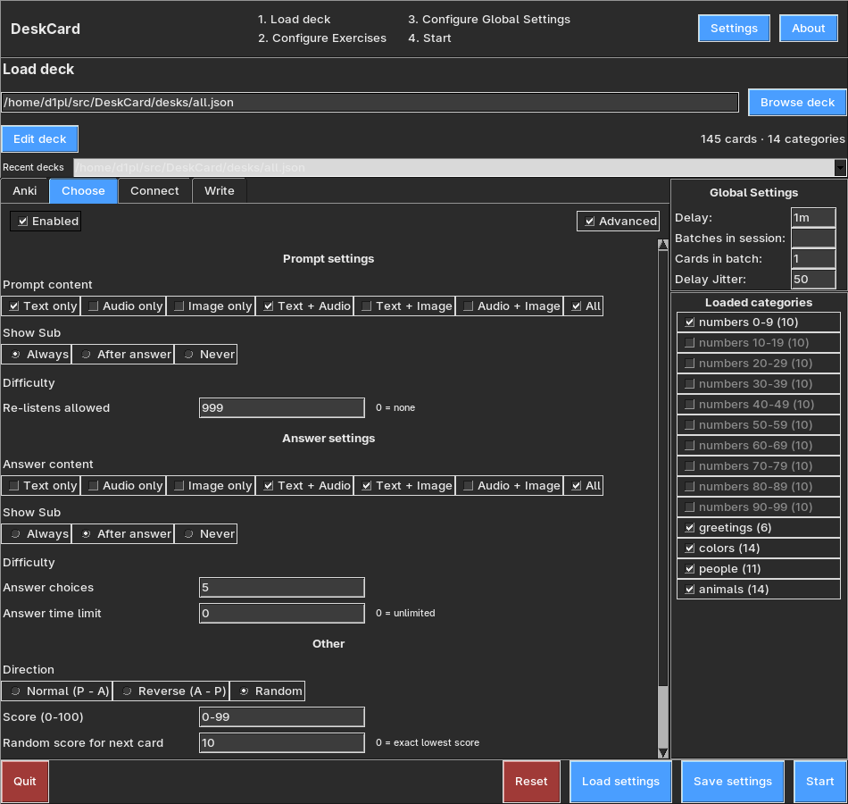
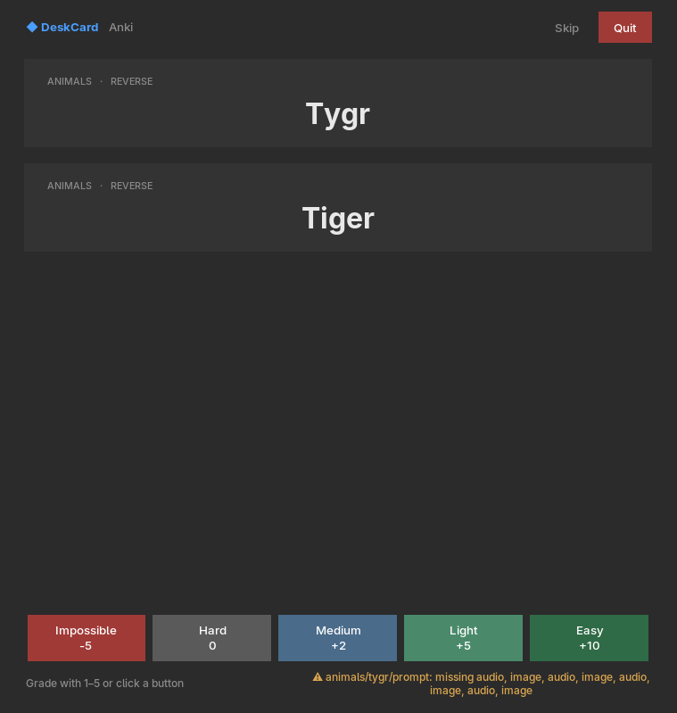
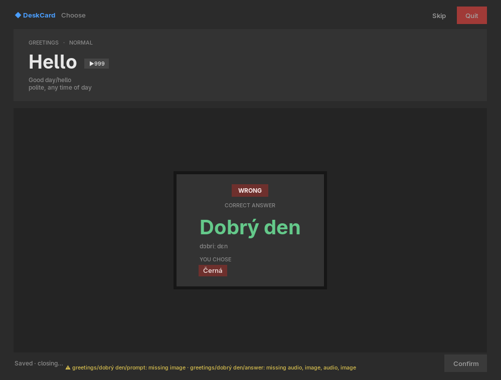
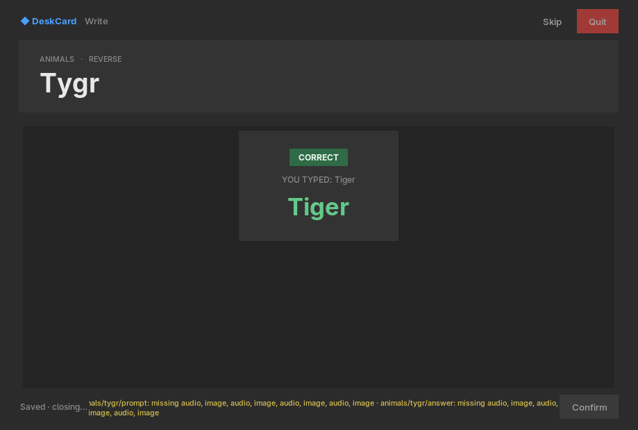

DeskCard - flashcard app that overlays on top of your screen until you finish the exercise



*[See more](https://github.com/d1pl6/DeskCard/tree/main/showcase)*

## Table of Contents
- [Install](#install)
- [Usage](#usage)
- [Exercises](#exercises)
    - [Anki](#anki)
    - [Choose](#choose)
    - [Connect](#connect)
    - [Write](#write)
- [Global settings](#global-settings)
- [Settings](#settings)
- [Uninstall](#uninstall)
- [License](#license)

## Install
Python 3.10+

For audio, install `pygame-ce` (`python-pygame` or `python3-pygame-ce`, depending on your distro).

On Linux, install `tkinter` if it does not come with Python.

Install optional dependencies. `pygame-ce` for audio, `pillow` for images:
```sh
pip install pygame-ce pillow
```

Install or DeskCard on your system:
- CLI:
    ```sh
    pip install .
    ```
- App:
    ```
    # ~/.local/share/applications/deskcard.desktop
    [Desktop Entry]
    Type=Application
    Name=DeskCard
    Exec="/usr/bin/<python*>" "/path/to/app.py"
    # Or Exec="deskcard"
    Terminal=false
    ```

## Usage
Use `python tools/validator.py [all|text|sub|audio|image|other] FILE` to check a deck for problems. See `python tools/validator.py --help` for details.

```sh
# Launch
python -m app
python app.py
```

## Exercises
### Global Exercise settings
- Prompt settings:
    - Prompt content `[Text only|Audio only|Images only|Text+Audio|Text+Image|Audio+Image|All]` - What is shown in prompt.
- Answer settings:
    - Answer content `[Text only|Audio only|Images only|Text+Audio|Text+Image|Audio+Image|All]` - What appears after you answer.
- Other:
    - Direction `[Normal (P - A)|Reverse (A - P)|Random]`
    - Score (0-100) - set the score for cards per exercise (e.g you can set 0-49 in 'Anki', 50-99 in 'Choose' and 'Connect' and 100 in 'Write')

### Anki
Classic (almost) Anki.
Answer in your head, click **Show Answer**, then choose how difficult it was to answer.

### Choose
Pick the answer from the choices, then click **Confirm** (or press Enter).

- At least 2 choices are required.

### Connect
Connect left side with right one, then click **Confirm** (or press Enter).

- At least 2 connections are required.

### Write
Write answer, then click **Confirm** (or press Enter).

- An empty answer counts as wrong.
- "Answer content" controls what appears after you answer.

## Global settings
- Delay {T} - Wait before each batch, including the first, e.g. 30s, 1m30s, 3h.
- Batches in session {N} - Number of batches shown in the session.
- Cards in batch {N} - Cards shown per batch; the delay is applied before each batch.
- Delay Jitter {N} - % randomness added to the delay, e.g. 50% of 100s → 50–150s.

## Settings
- `Restrict closing exercise` - You cannot close the exercise window from within the app (force-closing is always available).
- `Score change` - Adjust the score change for "Impossible", "Hard", "Medium", "Light" and "Easy".
- `Always on top during exercises` - Exercise window stays on top of other windows.

- Other:
    - **Exercise**: `Exercise window opacity`; `Show "Skip" / "Quit"`; `Confirm on quit/reset`; `Show "time passed: "`; `Show "cards in batch: "`; `Show "session batches: "`; `Position` (for the session status row).
    - **Window**: `Remember window geometry`; `Remember window position / monitor`.
    - **Startup**: `Auto-load last deck on startup`; `Auto-load last settings file on startup`; `Default global settings` (Delay, Batches, Cards, Jitter).
    - **Images**: `Image display mode` (fit/stretch/original); `Max image size`; `Font scale`.
    - **Advanced**: `Enable debug log file`; `Increase direction counter in normal/reverse modes`.

## Uninstall
Delete saved configs, decks, the DeskCard folder, and the DeskCard config directory:
- `~/.config/DeskCard` on Linux
- `%APPDATA%\DeskCard` on Windows
- `~/Library/Application Support/DeskCard` on macOS

Optional dependencies: `pygame-ce` for audio and `pillow` for images.

## License
DeskCard is licensed under the GPL-2.0-or-later. If you did not get a copy, please see https://www.gnu.org/licenses/.
